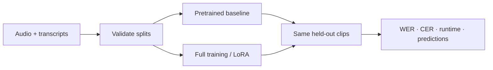

# asr-finetuning-lab

Fine-tune Whisper. Compare full training and LoRA. Keep the evidence.

English and Spanish · Python package + CLI · Free-Colab recipes · Apache 2.0



## Start

Python 3.11–3.13 tested. Install PyTorch for your hardware first if needed.

```bash
python -m pip install -e ".[train]"
asr-lab validate data/demo/en/manifest.jsonl
asr-lab train --config recipes/en-lora.yaml --manifest data/demo/en/manifest.jsonl --output runs/en-lora --max-steps 2
```

Use the bundled data to verify the pipeline. Use the larger [experiment workflow](docs/experiments.md) to evaluate quality.

- [Open English Colab](https://colab.research.google.com/github/jorgeutd/asr-finetuning-lab/blob/main/notebooks/english.ipynb)
- [Open Spanish Colab](https://colab.research.google.com/github/jorgeutd/asr-finetuning-lab/blob/main/notebooks/spanish.ipynb)
- [Read measured results](results/README.md)

## Layout

```text
src/asr_lab/    reusable data, training, evaluation, CLI
recipes/       English/Spanish × full/LoRA
notebooks/     Colab entry points; no duplicated training code
data/demo/     small attributed public speech samples
docs/          theory, data contract, experiment workflow
results/       measured runs and their limitations
tests/         data, metrics, training, checkpoint checks
```

## Understand

[Theory](docs/theory.md) · [Data contract](docs/data.md) · [Run an experiment](docs/experiments.md)

Whisper-tiny is the default to keep examples accessible. Results from small subsets are demonstrations, not production benchmarks. GPU availability on free Colab varies.

## Develop

```bash
python -m pip install -e ".[train,dev]"
ruff check .
ruff format --check .
pytest -q
python -m build
```

Code: [Apache 2.0](LICENSE). Demo audio: [FLEURS / CC BY 4.0](data/demo/ATTRIBUTION.md).
