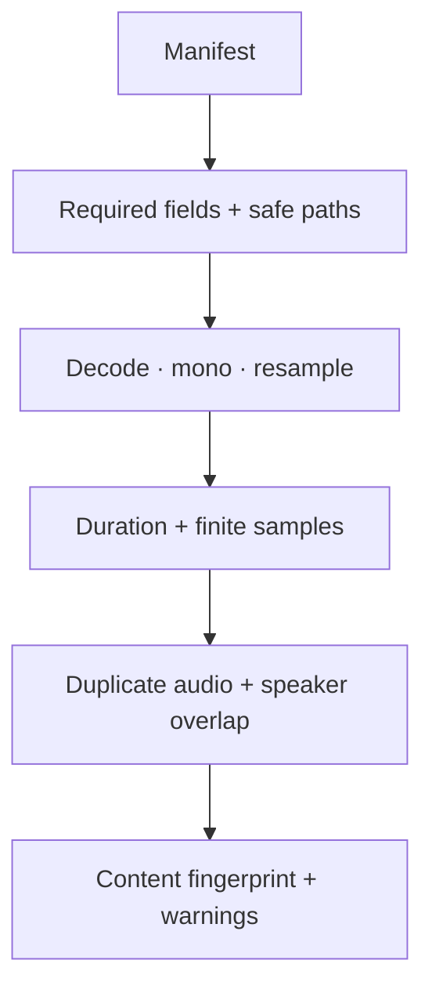

# Data contract

One JSON object per line. Audio paths are relative to the manifest directory.

```json
{"id":"clip-001","audio":"clips/001.flac","text":"Hola, mundo.","language":"es","split":"train","speaker_id":"speaker-01"}
```

Required: `id`, `audio`, `text`, `language` (`en` or `es`), `split` (`train`, `validation`, `test`). Optional: `speaker_id`, `text_id`, source, revision, license, domain, channel.



`asr-lab validate manifest.jsonl` rejects duplicate IDs, duplicate audio, cross-split speaker IDs, missing files, path escapes, empty labels, and clips outside 0.1–30 seconds. Quiet/clipped clips are flagged for review, not silently deleted. Oversized transcripts fail before training.

## Public examples

FLEURS provides English (`en_us`) and Latin American Spanish (`es_419`). The fetch command pins the resolved dataset revision, preserves original splits, and records selected IDs and checksums. It selects the first eligible clips in dataset order: a convenient subset, not a representative sample.

The published fields do not expose speaker IDs. We report this limitation instead of claiming independent speaker-disjoint verification. Identical audio is still rejected. Bootstrap groups use text IDs where available.

The bundled clips are a small execution fixture. Larger experiments download into ignored `data/local/`; model checkpoints and run outputs stay in ignored `runs/`.

## Bring your own data

Keep speaker IDs consistent across files. Assign speakers/sessions to one split before creating segments. Use consented recordings and a consistent transcript style. For long recordings, align and segment audio and text together; never truncate audio while keeping the entire label.

Do not commit private audio, transcripts, credentials, or personal metadata. Publishing results is a separate review step.

[FLEURS source](https://huggingface.co/datasets/google/fleurs) · [Paper](https://arxiv.org/abs/2205.12446)
