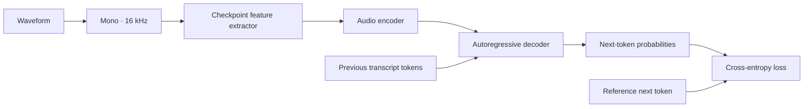

# From sound to a training signal

Whisper is an encoder-decoder Transformer. It predicts transcript tokens from audio features.

Training uses teacher forcing: the decoder receives the reference prefix. Inference uses its own predicted prefix. Padding labels are `-100`, so they do not contribute to loss. The decoder-start token is inserted once.

## Full training or LoRA

Full fine-tuning updates the base model's trainable weights. It offers more flexibility but needs gradients and optimizer state for every trainable parameter. Whisper's fixed encoder positional embeddings remain frozen.

LoRA freezes the base weights and learns a low-rank update:

`W' = W + (alpha / rank) × B × A`

Here, LoRA targets attention query/value projections. Fewer trainable parameters reduce optimizer state; activations still consume memory. The best method depends on measured quality, memory, and training time.

The default recipes share data, seed, batch size, and step budget. Learning rates differ by method. This is a recipe comparison, not an exhaustive hyperparameter search.

## Data matters

- Audio and transcripts must describe the same segment.
- Preserve accents in Spanish. Decide how to label numbers, fillers, and punctuation.
- Split by speaker/session when those IDs exist. Never randomly split related recordings.
- Use validation data for checkpoint selection; leave test data untouched until evaluation.
- Review difficult examples instead of deleting everything the baseline gets wrong.

This package uses the checkpoint's processor. Mel dimensions differ across Whisper checkpoints; do not hard-code a feature extractor copied from another model.

## Read the result

`WER = (substitutions + deletions + insertions) / reference words`

Corpus WER sums counts across clips; it is not the mean of per-clip percentages. WER can exceed 100%. CER applies the same idea to characters. The shared normalizer case-folds text and replaces punctuation with spaces while retaining accents and digits.

A paired bootstrap resamples matching evaluation groups to estimate uncertainty in the WER difference. It does not capture training-seed variation or prove that the model generalizes to another domain.

## Inference boundary

The v1 API transcribes labeled clips up to 30 seconds. Long recordings need segmentation and transcript alignment for training. Whisper's long-form decoding does not make it a native streaming model. Live partials, diarization, and a serving fleet are outside this release.

## Sources

- [Whisper paper](https://arxiv.org/abs/2212.04356)
- [Whisper processor and generation](https://huggingface.co/docs/transformers/v4.57.6/en/model_doc/whisper)
- [LoRA paper](https://arxiv.org/abs/2106.09685)
- [PEFT LoRA](https://huggingface.co/docs/peft/v0.18.0/en/conceptual_guides/lora)
