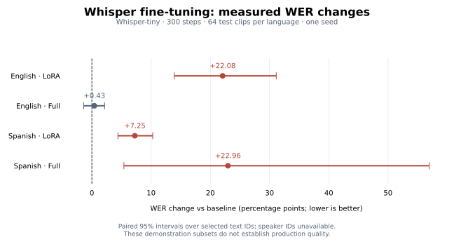

# Measured runs

**Colab / Tesla T4:** Whisper-tiny; 300 optimizer steps; seed 42;
256 train / 32 validation / 64 test clips per language.
Effective batch: 16. Best checkpoint selected by validation WER.

No recipe demonstrated an improvement: three regressed and one was inconclusive on these subsets.

## Held-out WER

- **EN / lora**: 13.60% → 35.68%; difference +22.08 points, 95% CI [+13.93, +31.13]. Candidate higher on selected clips.
- **EN / full**: 13.60% → 14.03%; difference +0.43 points, 95% CI [-1.38, +2.15]. Inconclusive.
- **ES / lora**: 19.27% → 26.53%; difference +7.25 points, 95% CI [+4.40, +10.28]. Candidate higher on selected clips.
- **ES / full**: 19.27% → 42.24%; difference +22.96 points, 95% CI [+5.40, +56.95]. Candidate higher on selected clips.

## Training cost

- **EN / lora**: 5.63 minutes; 0.31 GiB peak CUDA allocation; 147,456 trainable parameters.
- **EN / full**: 5.49 minutes; 0.78 GiB peak CUDA allocation; 37,184,640 trainable parameters.
- **ES / lora**: 5.81 minutes; 0.35 GiB peak CUDA allocation; 147,456 trainable parameters.
- **ES / full**: 7.27 minutes; 0.78 GiB peak CUDA allocation; 37,184,640 trainable parameters.

Times include validation and checkpoint saving. CUDA allocation is not total system memory.

## Evidence and limits

- [English artifacts](colab-t4/en/) · [Spanish artifacts](colab-t4/es/).
- Artifacts include CER, per-clip predictions, paired intervals, recipes, source IDs, model/data revisions, and dependency versions.
- FLEURS / CC BY 4.0, Conneau et al. (2022), Google. [Source](https://huggingface.co/datasets/google/fleurs).
- These are convenience subsets with one training seed. Intervals resample text IDs because speaker IDs are unavailable; they do not measure seed variation or establish production quality.
- Learning rates differ between methods. These results compare the supplied recipes; they do not establish a universally better training method.
- Colab initially exposed an editable-import issue and an incompatible optional torchvision installation. Both notebook setup issues were fixed before training.
- An overnight disconnect prevented verification and export of the first GPU attempt. [Partial record](colab-t4/interrupted-en.json). The completed experiment was rerun.

## CPU execution checks

[Four 12-step smoke runs](cpu-smoke/README.md) verify both methods in both languages. Their six-clip comparisons are inconclusive.

Regenerate the chart from saved comparisons: `pip install -e ".[plot]"`, then `python scripts/plot_results.py`.
